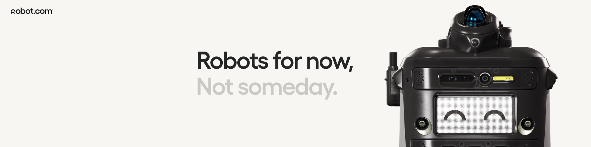
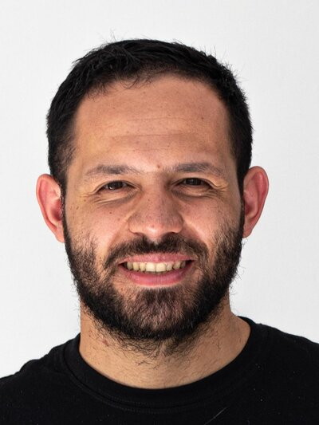
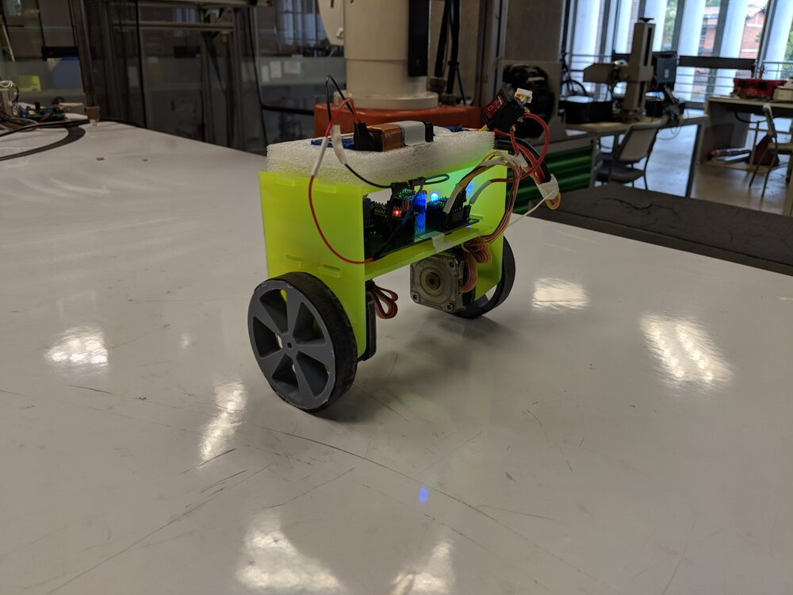
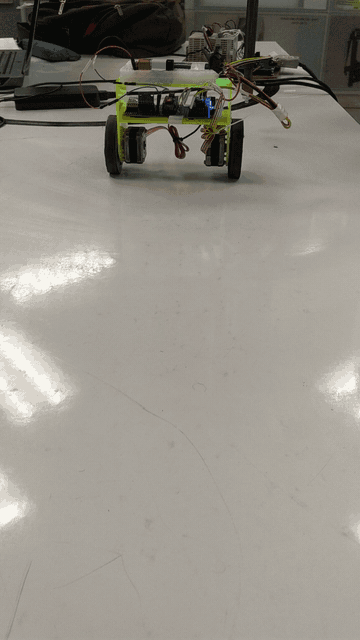

# Alejandro Serna Escobar

### Technical Project Manager · AI & Robotics · Mechanical Engineer

*Bridging autonomous robots, data and sustainable engineering — from lab prototypes to fleets on the street.*

`#TechnicalProjectManagement` `#Robotics` `#AI` `#DataAnalytics` `#IoT` `#Sustainability` `#LCA`

---

## ⚡ TL;DR

**Technical Project Manager of the AI & Robotics team @ [robot.com](https://robot.com) (formerly Kiwibot)** · 8+ years leading engineering, R&D and sustainability projects · Mechanical Engineer & Specialist in Integrated Design of Technical Systems (EAFIT) · Based in Medellín, Colombia 🇨🇴

- 🤖 **Today:** Running delivery for a ~30-person AI, software, hardware & robotics team building autonomous delivery robots — helped cut supervision cost per mile by more than 85%
- 📊 **How I work:** Agile/Scrum, OKRs & KPIs, dashboards that turn fleet and sprint data into decisions
- 🌱 **Before that:** 6 years at ICIPC on circular economy, Life Cycle Assessment (LCA), recycling, biopolymers and Industry 4.0
- 🛠️ **Roots:** A mechanical engineer who has built drones, self-balancing robots and autonomous vehicles by hand
- 📫 **Reach me:** [LinkedIn](https://www.linkedin.com/in/alejandro-serna-escobar-a6b493115/) · [asernae7@gmail.com](mailto:asernae7@gmail.com)

---

## 👋 About me

<table>
  <tr>
    <td width="180" valign="top">
      
    </td>
    <td valign="top">

Hi! I'm Alejandro. I started out designing and building machines, moved into research on making plastics and products more sustainable, and today I help an AI & Robotics team get autonomous robots out of the lab and into the real world.

What I enjoy most is the translation work: taking what a client or an executive *wants* and turning it into specs, backlogs and roadmaps an engineering team can actually deliver — and then measuring whether it worked.

A few things about me beyond the Gantt charts:

* ⚽ **Football is life** — a proud **FC Barcelona** fan, and on the console I'm a FIFA guy through and through. 🎮
* 📚 **Bookworm with a classic streak** — Jules Verne is my favorite author (no surprise for an engineer who loves machines), I'm a big *Game of Thrones* fan, and right now I'm reading ***Don Quixote*** — just for fun. Yes, really. 🐎
* 🦸 **MCU die-hard** — I watched both *Infinity War* and *Endgame* at the midnight premiere, went to work the next morning and proudly spoiled everyone. No regrets — I'd do it again. 🫰
* ❤️ **My family is my engine** — they're the reason behind everything I build.

    </td>
  </tr>
</table>

### 🎯 Goals

* 🧭 **Career:** No specific title on the horizon — just enjoy the ride, keep learning and keep building cool things with great people. — *Always WIP*
* 📜 Earn the **PMP®** and **PSM I** certifications. — *WIP*
* 🏟️ Watch **El Clásico live at the Camp Nou**. Visca el Barça! 🔵🔴 — *Not started*
* 📊 **[Barça & Data](https://github.com/asernae7/Barca-and-data):** mixing my two passions — football analytics around FC Barcelona. — *WIP*
* 📖 **[El Mundo de Lalito](https://elmundodelalito-f4910.web.app/)** — our family project: an AI web app that creates personalized, illustrated and narrated stories for kids. Go see it for yourself! — *Beta*
* 👨‍👩‍👧 **Build a family** — a chef wife (lucky me 🍽️), a stepdaughter and two beautiful cats 🐈🐈. — *Done ❤️*

---

## 🚀 What I'm doing now

**Technical Project Manager — AI & Robotics @ robot.com / Kiwibot** *(2022 – Present)*

I'm the link between executive leadership, enterprise clients and an engineering team working on computer vision, edge AI, ROS-based autonomous navigation and IoT telemetry for a fleet of autonomous delivery robots.

- **Delivery:** Brought Agile/Scrum practices to the team, improving sprint predictability, velocity and release cycles
- **Alignment:** Turn business priorities and client requests into technical requirements, backlogs and roadmaps
- **Data & KPIs:** Build dashboards and reports to track OKRs, sprint throughput, robot fleet reliability and budget execution
- **Risk & resources:** Manage scope, schedule, budget and risk across hardware/software rollouts in the field

#### 🏆 Highlights

* 💰 **-85%+ supervision cost per mile** — part of the push that moved campuses from teleoperation to autonomous operation, so supervisors handle exceptions instead of driving robots one by one. Today 500+ robots have completed 2.5M+ tasks across campuses and city sidewalks. ([Read the story](https://www.linkedin.com/pulse/scaling-smarter-economics-autonomous-robot-fleets-robot-com-4gwyf/))
* 🐕 **New robot in under 3 months** — coordinated the whole engineering department to take **R-Dog**, a brand-new robotic product, from kickoff to delivery in less than 3 months.
* 👥 **~30-person engineering team** across AI, software, hardware and robotics, kept aligned with clients and leadership.
* ⚡ **4 hours → 1 command** — built an automated autonomy report generator that pulls from multiple BigQuery sources and saves ~4 hours of manual work every week.

---

## 🧰 How I think about my skills

### 📋 The Project Manager
- Agile & Scrum, Product Development Lifecycle (PDLC), technical roadmapping
- Scope, schedule, budget and risk management
- Stakeholder management: executives, enterprise clients and engineers
- Cross-functional team leadership, change management and mentorship

### 📈 The Data Person
- KPI & OKR dashboarding: velocity, downtime, reliability, autonomy metrics
- Python (Pandas), SQL, BigQuery, Looker Studio, Google Sheets, advanced Excel
- Automated reporting pipelines (e.g. a weekly autonomy report generator that pulls from multiple BigQuery sources)

### ⚙️ The Engineer
- Mechanical design & systems engineering — SolidWorks, MATLAB, LabVIEW
- Robotics & embedded — Arduino, sensors, control, computer vision
- Sustainability — Life Cycle Assessment (OpenLCA), circular economy, eco-design, biopolymers

---

## 🗺️ My journey

*Most recent first.*

#### 🤖 robot.com / Kiwibot — Technical Project Manager, AI & Robotics *(2022 – Present)*
See [What I'm doing now](#-what-im-doing-now).

#### 🌱 ICIPC — Research Consultant Associate, Sustainability & Industry 4.0 *(2016 – 2022)*
*Instituto de Capacitación e Investigación del Plástico y del Caucho, Medellín*

- Managed research and technical development projects for industrial clients, combining Industry 4.0, IoT sensor networks, mobile/web interfaces and advanced materials
- Led circular economy and eco-design engagements: Life Cycle Assessments, mechanical recycling and plastic product life cycle design to reduce carbon footprint
- Core member of the **Value-Added Packaging Cluster**; lecturer in virtual and in-person training courses on biopolymers and sustainable manufacturing

**Highlight projects:**

* 🗑️ **Smart recycling bin (MVP)** — designed and built an IoT-enabled bin that guided and trained university students on proper waste separation.
* 🧊 **Biopolymer compound for frozen-goods transport** — formulation and pilot production runs of a bio-based material for cold-chain packaging.
* 🌬️ **Oxygen sensor for modified-atmosphere packaging** — designed and tested a prototype to measure O₂ inside packaged products.
* 🍌 **Breathable valve for climacteric fruit** — industrial design of a valve that controls ripening of climacteric produce — *patent pending*.
* ♻️ **10+ Life Cycle Assessments** of plastic products: packaging, plastic lumber and recycled-plastic paving mixes.

---

## 🎓 University projects

Before managing robots, I built them. A few projects from my time at **Universidad EAFIT**:

### 🛸 Teleoperated quadcopter drone
*B.Sc. Mechanical Engineering — final-semester project*

<!-- ✍️ TODO: drone photo/GIF, e.g.  -->

Our capstone project: we designed, built and programmed a quadcopter from scratch, teleoperated from a smartphone. Mechanical design, electronics and flight software, all in one semester.

### ⚖️ Self-balancing robot
*Specialization in Integrated Design of Technical Systems*

<table>
  <tr>
    <td width="50%" align="center">
      
    </td>
    <td width="50%" align="center">
      
    </td>
  </tr>
</table>

🎥 <a href="assets/self-balancing-robot.mp4">Watch the full video</a>

A two-wheeled inverted pendulum built from scratch: laser-cut acrylic chassis, 3D-printed wheels, stepper motors, an **MPU6050 IMU** and an **Arduino Nano** running a **PID** control loop to keep it upright.

The hardest part? Tuning the PID — hours of tweaking gains until it finally stopped falling over and stood on its own. 😅

### 🦾 SCARA robot sorter with computer vision
*Specialization in Integrated Design of Technical Systems*

Programmed a SCARA robot that sorts parts by shape and color using a vision system.

<!-- ✍️ TODO: photo/video if available -->

### 🚗 Internet-controlled self-driving vehicle
*Specialization in Integrated Design of Technical Systems*

Designed, built and programmed a small autonomous vehicle that can be controlled over the internet.

<!-- ✍️ TODO: photo/video if available -->

---

## 📜 Education & certifications

| | |
|---|---|
| 🎓 **Specialist in Integrated Design of Technical Systems** — Universidad EAFIT | GPA 4.70 / 5.00 |
| 🎓 **B.Sc. Mechanical Engineering** — Universidad EAFIT · Teaching assistant for Technical Drawing and Statics | GPA 4.57 / 5.00 |
| 📘 Engineering Management — Platzi | 2024 |
| 📘 Google Project Management Professional Certificate — Coursera | 2023 |
| 📘 Diploma in Machine Learning with Python — Universidad EAFIT | 2020 |
| 🎯 PMP® & Professional Scrum Master (PSM I) | In progress |

## 🌍 Languages

🇨🇴 **Spanish** — Native · 🇺🇸 **English** — Fluent (TOEIC 925) · 🇩🇪 **German** — Elementary (A2)

---

**Let's talk about robots, data, projects or sustainability.**

